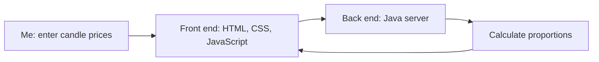

# Candle Proportions

> A personal candle-proportion calculator that helps me check stock candles against my investment criteria.

**Author:** Mahdi Chowdhury · **Course:** CMP 464/343 Product 1 · **Last updated:** November 2, 2026

## 1. About Me (the User)

I am an investor trying to assess stock setups and their possible outcomes.

**The last 3 times this happened:**

1. At Parkchester, I needed a candlestick's proportions to help evaluate an investment. I opened the chart and sent a screenshot to ChatGPT to get an answer, which took a lot of time.
2. While backtesting at home, I could not confidently judge the proportions by eye. This caused stress for several minutes, and I manually entered the prices.
3. While reviewing Disney, I found a setup that had failed and felt panicked until I checked its actual proportions.

**What it costs me:**

- **Time:** About 5 hours monthly.
- **Money:** My estimated potential cost is $1,000; this is not a verified loss caused by this process.
- **Energy:** The anticipation and uncertainty drain my energy.
- **Joy:** The process takes enjoyment out of my analysis.

## 2. Problem Statement

**Gut check:**

I need immediate details about a candlestick's proportions because this would automate part of my analysis.

**Five Whys:**

1. **Why do I need candle proportions?**  
   To check whether a stock's daily candle fits my investment criteria.
2. **Why do I need exact proportions instead of judging visually?**  
   Visual estimates can be inaccurate, and I might mistakenly identify a candle as a spinning top.
3. **Why does misidentifying a spinning top matter?**  
   It could lead me to accept a setup that I consider less reliable.
4. **Why do I consider that setup less reliable?**  
   I believe it is more volatile and less dependable. I still need evidence or a concrete example to support this belief.
5. **Why is my current process difficult?**  
   I have to open Robinhood, take and crop an OHLC screenshot, open ChatGPT, upload it, and explain what I mean by proportions. Without that context, ChatGPT may misunderstand my request.

**Problem statement:**

When I analyze a stock's daily candle to check whether it meets my investment criteria, I struggle to get its real-body, upper-wick, and lower-wick percentages quickly and consistently, which costs me about one hour across roughly 20 checks per week. This happens because I have to move the price information between services and explain the calculations I want.

Right now I open Robinhood, take and crop a screenshot of the open, high, low, and close prices, then upload it to ChatGPT and request the proportions, but this takes several steps and my request can be misunderstood.

**I'll know this is solved when:** I can get the three percentages consistently without taking, cropping, and uploading screenshots or repeatedly explaining what “proportions” means.

## 3. Existing Solutions

I've used Robinhood screenshots with ChatGPT and a calculator to find candle proportions. Robinhood provides the open, high, low, and close prices, and ChatGPT calculates the proportions, but taking, cropping, and uploading screenshots takes time, and I sometimes have to explain what I mean. A calculator is convenient for the arithmetic, but calculating all three proportions takes even longer and feels tedious.

**The gap:** What's missing for me is a quick, consistent way to get the real-body, upper-wick, and lower-wick percentages without repeating these steps.

## 4. Features & Benefits

| Feature (what it does) | Benefit (how my life gets better) | MVP or Later? |
|---|---|---|
| Calculate candle proportions | Get consistent percentages without repeating the arithmetic. | MVP |
| Explain the candlestick in text | Understand the calculated proportions more easily. | MVP |
| Provide a question box | Ask follow-up questions about the candle. | Later |

**MVP:**

- Calculator.
- Text explaining the candlestick.

**Later:**

- Ask questions.

**Not doing:**

- Predictions.

## 5. Tech Stack

### Front end

- **Surface:** Web.
- **Tools:** HTML, CSS, and JavaScript.
- **Why:** A browser interface lets me enter the open, high, low, and close prices and immediately see the candle's proportions and explanation while analyzing stocks.

### Back end

| Piece | Choice | Why |
|---|---|---|
| Server / API | Java with its built-in HTTP server | Uses a language I'm learning and handles the candle calculations. |
| Data storage | No database for the MVP | I only need to calculate the current candle, so saving previous results is unnecessary for now. |
| Outside services (optional) | None required for the MVP; Alpha Vantage for stock lookup and OpenAI API for questions later | Manual entry supports the core calculator. Outside services could reduce typing and support follow-up questions. |
| Hosting / deploy | Locally on my computer | Lets me build and test the product for personal use before deciding whether I need online hosting. |

### Architecture sketch



The browser displays the proportions, candle drawing, and explanation. No database is needed for the MVP.

## 6. Open Questions

I am still unsure about the OpenAI API and the API for retrieving stock candlesticks. These could save a lot of time, but I need to find out whether they cost money and how much they would cost for my usage before moving forward.

---

## Implementation and setup

The sections above describe my product spec and intended MVP. The current implementation also includes optional stock lookup and candle chat; their setup and testing limitations are documented below.

## Authorship

Written collaboratively by **Mahdi Chowdhury and OpenAI Codex**. Mahdi supplied the product idea, personal requirements, and implementation direction; Codex generated the initial code and explanatory comments under that direction.

This credit covers the Java source, front end, tests, run scripts, Git configuration, and VS Code configuration, including `.vscode/launch.json` and `.vscode/settings.json`. Those two files remain valid JSON without comment headers.

For a line-by-line explanation of the calculations, read the comments in [`src/CandleCalculator.java`](src/CandleCalculator.java).

## Run in VS Code

Install a **JDK 17 or later**. VS Code’s Extension Pack for Java is helpful for editing and debugging, but the terminal commands do not need it.

Clone this repository, or run `git pull` if you already cloned it. Open the project folder in VS Code. From its terminal:

**Windows PowerShell or Command Prompt:**

```powershell
.\run.bat
```

**macOS or Linux:**

```sh
sh run.sh
```

Open **http://localhost:8080** in your browser. Click **Try an example candle**, or enter your own OHLC prices. Stop the server with Ctrl+C.

The scripts compile the Java source into `out/` and then start `CandleServer`. They invoke the JDK compiler module through `java`, so a separate `javac` executable on PATH is unnecessary. If Java reports that `jdk.compiler` is missing, install a full JDK.

You can also compile and run directly from the project root:

```sh
javac -d out src/CandleCalculator.java src/MarketData.java src/CandleServer.java src/CandleChat.java src/Json.java
java -cp out CandleServer
```

With the Java extension installed, the included `.vscode/launch.json` also supports **Run Candle Proportions** in Run and Debug. Run scripts read any API key from the terminal's environment; restart VS Code from that environment if using its debugger instead.

## Enable stock lookup (optional)

1. Obtain a key from [Alpha Vantage](https://www.alphavantage.co/support/#api-key).
2. Stop the server, set the environment variable in your terminal, and start it again.

**Windows PowerShell:**

```powershell
$env:ALPHA_VANTAGE_API_KEY="YOUR_KEY"
.\run.bat
```

**macOS or Linux:**

```sh
export ALPHA_VANTAGE_API_KEY="YOUR_KEY"
sh run.sh
```

Keep your actual key out of source code and Git. It is used only by the Java server and is never returned to the browser. `.env` files are ignored by Git but are **not automatically loaded** by this application.

Select **Stock lookup**, enter a symbol, and optionally select a date. A blank date selects the latest available candle and shows its actual date. A specified date is matched exactly; weekends or missing dates are never silently replaced.

### Data limitations

This uses `TIME_SERIES_DAILY`, `outputsize=compact`, `datatype=csv`: daily **unadjusted** prices for the latest 100 trading days. It is not a real-time quote. Data may lag and differ from another chart’s session or adjustment settings. API plan and usage limits apply. See the [provider documentation](https://www.alphavantage.co/documentation/#daily).

Successful responses are cached in memory for 15 minutes, up to 30 symbols. Restarting the server clears that cache. Selecting another date for an already-cached symbol does not make another provider request. Errors and missing dates appear explicitly; the application does not substitute demo data for failed lookups.

The provider adapter has been checked with CSV fixtures and error fixtures. A live lookup with a personal key still needs verification.

## Calculations

```text
Total range = High − Low
Real body   = |Close − Open|
Upper wick  = High − max(Open, Close)
Lower wick  = min(Open, Close) − Low
Percentage  = (Component ÷ Total range) × 100
```

Example: Open 100, High 110, Low 90, Close 105 gives **25% body, 25% upper wick, 50% lower wick**.

If all prices are equal, the range is zero and percentages are undefined (`null` in the API, `N/A` in the UI). A doji with a nonzero range has a 0% body. Rounded percentages can total 99.99% or 100.01%.

Prices must be positive, with up to 12 digits before the decimal and 8 after it. High must be at least both Open and Close; Low must be at most both. Prices are in the instrument’s quoted units; no currency conversion is performed.

## How the code fits together

| File | Responsibility |
|---|---|
| `src/CandleCalculator.java` | Validates prices and calculates candle parts; start reading here. |
| `src/CandleServer.java` | Serves the page and exposes JSON endpoints. |
| `src/MarketData.java` | Fetches, parses, and caches optional daily market data. |
| `web/index.html` | Page structure and accessible input forms. |
| `web/styles.css` | Responsive layout and appearance. |
| `web/app.js` | Sends requests to Java and renders results. |
| `web/explanation.js` | Turns the calculated proportions into factual, plain-language descriptions. |
| `tests/CandleTests.java` | Arithmetic, validation, randomized invariants, and provider-parser tests. |
| `tests/http_smoke.py` | Optional running-server checks using Python’s standard library. |

The browser sends OHLC values to Java, Java calculates the result, and JavaScript updates the page. Editing inputs clears previous results so an old result is not mistaken for a new calculation.

## API

Read-only data endpoints use GET; `/api/chat` uses POST and makes a potentially billable OpenAI request. All return JSON. Errors return an appropriate non-200 HTTP status and an `error` string.

- `/api/status` — whether a stock-data key is configured (not a validation of the key).
- `/api/calculate?open=100&high=110&low=90&close=105` — manual calculation.
- `/api/candle?symbol=AAPL&date=2026-10-23` — exact trading-date lookup; omit date for latest available.

- `POST /api/chat` — question, four OHLC price strings, and optional recent user/assistant history. Requires a same-origin request and the `X-Candle-Chat: 1` header.

The server listens only on `127.0.0.1` for local use. It has no login, trade execution, or persistent portfolio storage. Do not expose it publicly without adding an appropriate hosting/security design. To change the default port, set `PORT` before starting the server.

## Test

**Windows:** `test.bat`

**macOS/Linux:** `sh test.sh`

Tests cover bullish and bearish candles, dojis, zero range, full-body candles, decimal prices, invalid OHLC, 500 generated valid candles, provider CSV parsing, provider errors, and missing API keys.

For optional HTTP checks, start the server **without an API key** on port 8080, then run `python tests/http_smoke.py` in another terminal.

## Status and next steps

First implementation complete. Java compilation, calculation/parser tests, JavaScript syntax, and local HTTP integration checks pass. Browser visual/interaction verification and a live provider lookup are still to be completed.

Suggested learning order: understand `CandleCalculator`, run its tests, follow a manual request through `CandleServer` and `web/app.js`, then connect your stock-data key. Automatic candle-pattern classifications and trading signals are intentionally outside this first version.

## Candle explanations

After any successful manual calculation or stock lookup, **Reading this candle** explains the open-to-close direction, how the body compares with the combined wicks, what each wick measures, and where the close sits within the total range. Zero-range candles get a dedicated explanation without percentages. Editing inputs hides the old result and its explanation until you calculate again. **Copy breakdown + explanation** includes both.

These descriptions report the supplied prices; they do not infer the order of intraday moves, label a confirmed reversal, or predict the next candle. No AI service or extra API key is required for explanations. Named pattern classifications remain outside this version.

Optional explanation checks (requires Node.js): `node tests/explanation.test.js`. Node.js is only needed to run these JavaScript tests, not to run the Java app.

## AI candle chat

After calculating a candle, the **Ask about this candle** panel lets you ask questions and follow up. This is an OpenAI API integration, not an embedded ChatGPT account or access to your existing ChatGPT conversations. It needs an OpenAI API key with API access and available credits/billing. ChatGPT subscription access alone is not a configuration for this app.

Stop the server with Ctrl+C. In Windows PowerShell:

```powershell
$env:OPENAI_API_KEY="YOUR_OPENAI_API_KEY"
.\run.bat
```

macOS/Linux:

```sh
export OPENAI_API_KEY="YOUR_OPENAI_API_KEY"
sh run.sh
```

Create/manage keys at https://platform.openai.com/api-keys. Keep the actual key in your local environment, never in Git, browser code, screenshots, or chat messages. The key is independent of `ALPHA_VANTAGE_API_KEY`; manual candles can use AI chat without stock lookup. API usage may incur charges; check your API account's billing and usage limits.

Default model: `gpt-6-luna`. Set `OPENAI_MODEL` before starting Java to use another Responses-compatible model your API project can access. An invalid/unavailable model or key produces an error; the app does not pretend to generate a reply. See [Responses text generation](https://developers.openai.com/api/docs/guides/text) and [the default model](https://developers.openai.com/api/docs/models/gpt-6-luna).

On Send, the app sends your question, the displayed candle's OHLC prices (revalidated and recalculated by Java), and up to the last four chat messages to OpenAI. No request is sent merely by calculating or viewing a candle. Messages live only in page memory and clear when inputs change, you switch modes, click Clear chat, or reload. Requests use `store: false`; this is not a promise of zero provider retention. Consult [OpenAI data controls](https://developers.openai.com/api/docs/guides/your-data). Clearing the chat cannot retract a request already sent, which may still incur usage.

The assistant has no web access, live news, volume, prior candles, portfolio access, or trade execution. Replies are rendered as plain text. Generated answers can be mistaken; the ordinary calculator and rule-based explanation keep working without AI.

Implementation: `src/CandleChat.java` handles the provider call, `src/Json.java` handles bounded JSON parsing/serialization, and `web/chat.js` manages chat state. Requests have input/output limits, one concurrent provider call, a short cooldown, and same-origin checks for the local app. This is still a localhost-only personal application, not a multi-user hosted service.

Validation: Java chat payload/response fixtures and local HTTP checks cover validation, missing keys, text/refusal output, and cross-origin rejection. No live paid OpenAI call has been verified in this workspace.
